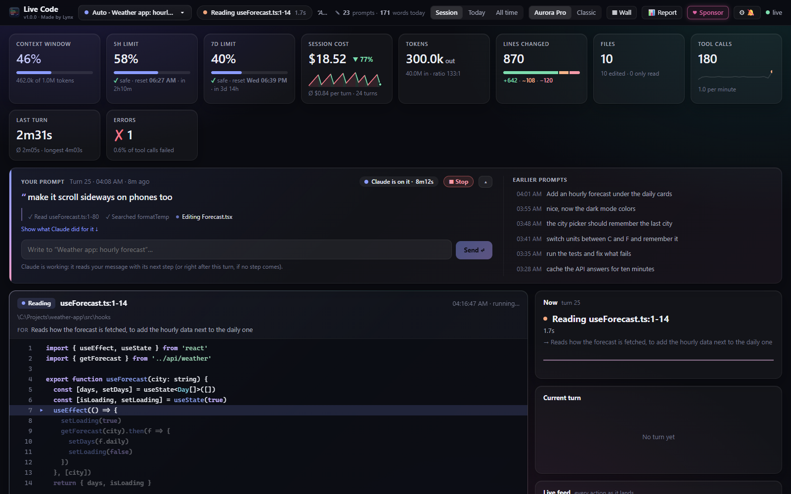
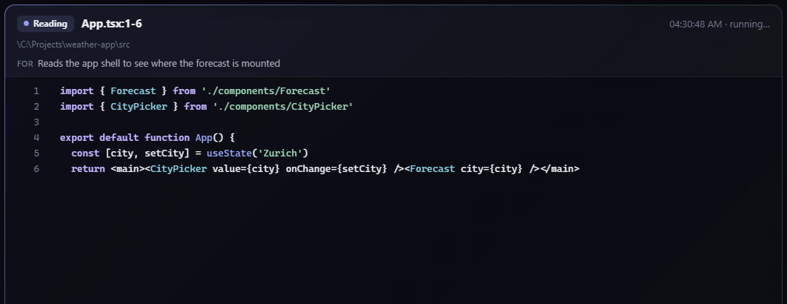
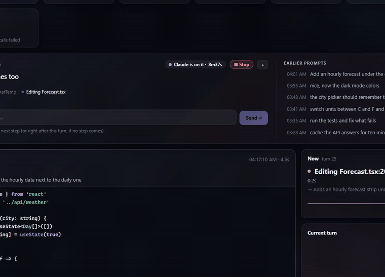
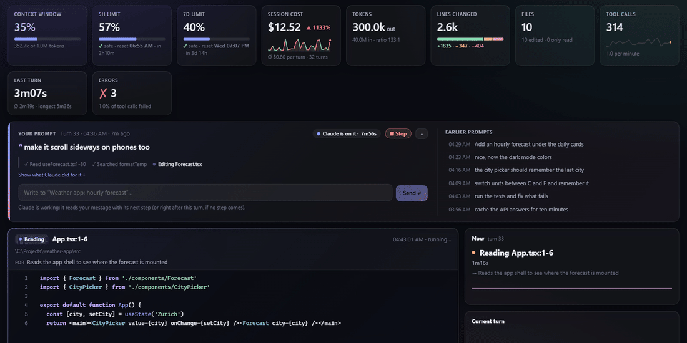
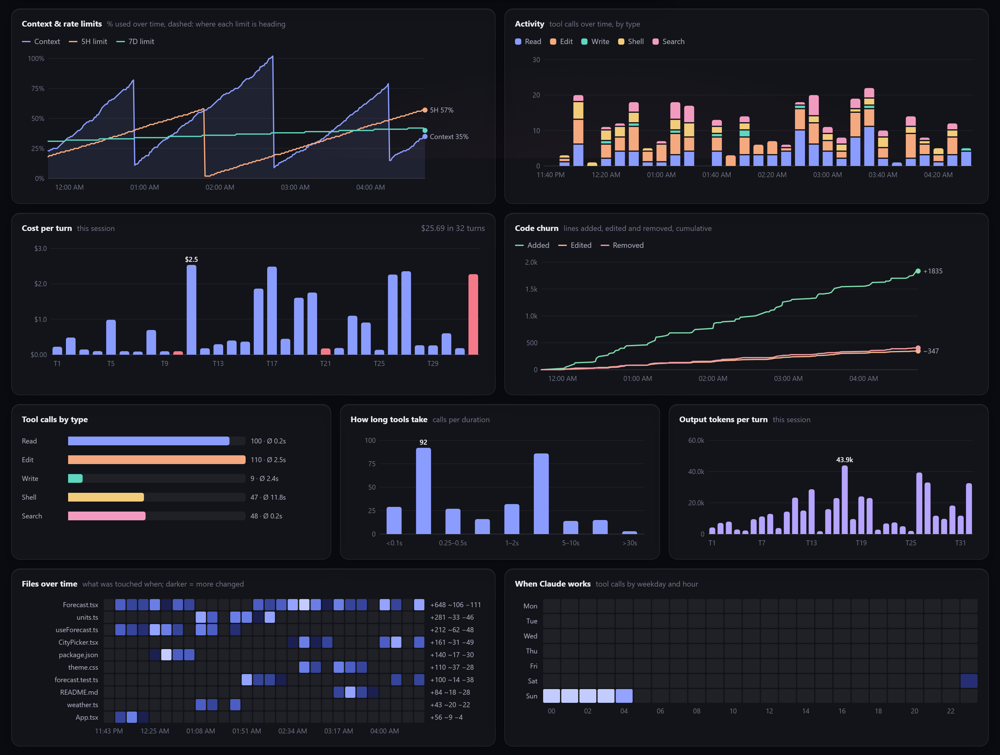
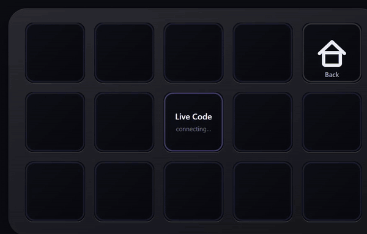
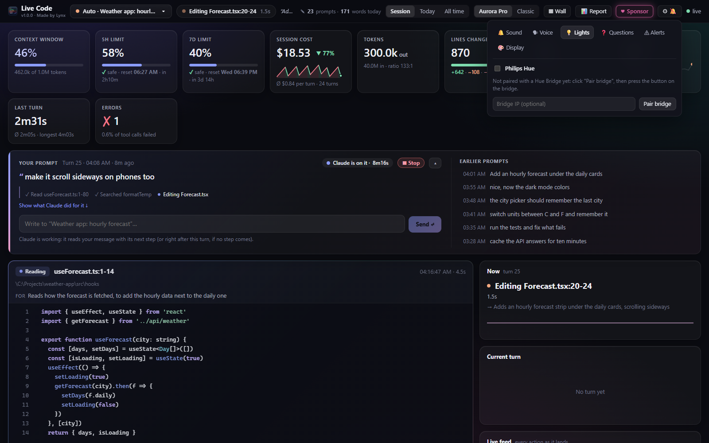
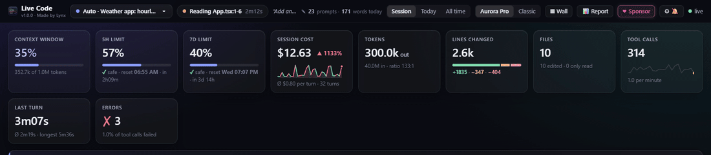

<div align="center">

# Live Code Dashboard

**Watch Claude Code work, live.** Every file it reads, every line it changes, what it costs, how close you are to your limits, all in one dashboard on your second screen, with a **Stream Deck** plugin and **Philips Hue** lights built in.

<a href="https://github.com/sponsors/CNLynx"></a>


[English](#english) · [Deutsch](#deutsch)



</div>

---

## English

### What it does

#### Live code view
The change Claude is making right now, typed out line by line with syntax colors, and under it a short note on *what it is for* ("Caches API answers for ten minutes so switching cities stays instant"). Reads, searches and commands show up too, one after another, so you never miss a step.



#### Limits & costs at a glance
Context window, 5-hour and 7-day limits with a live reset countdown and a projection of when you would hit them, session cost as a stock-style chart (red going up, green going down), tokens, lines changed, files, tool calls, errors. Tiles turn yellow and red at thresholds you choose, and a chime plays when a limit resets.

#### Every tile opens up
Click any tile for exact numbers and charts you can hover, or pop it out into its own **frameless window** (minimal or detailed) that remembers its place and screen.

**Session cost:** every turn's cost, red where it got dearer, green where cheaper; hover a point for its details.



**5-hour limit:** when it resets, how fast you use it now, and the pace that lasts until the reset.



#### The whole session in charts
Context and limits over time (with every compaction), activity by tool, cost per turn, code churn, how long tools take, output tokens, which files were touched when, and when you work.



#### And more
- **Talk back:** send Claude a message, stop it, or answer its questions straight from the dashboard.
- **Several chats at once:** pick a chat, or the *Wall* to see all of them side by side; a *Report* sums up the day and week by project.
- **Sound & voice:** a chime when a task is done, and optionally the summary read aloud with Edge's free natural voices (one voice per chat if you like).
- **It thinks with you:** a calm "thinking" view while Claude thinks longer, a terminal animation while commands run, and an alarm when Claude seems stuck.

### Stream Deck




The plugin turns a 15-key Stream Deck into a Claude console:

| Row | Keys |
|---|---|
| top | your chats (switch with a press), ⌂ back |
| middle | what Claude does now, turn time, context, 5-hour limit, cost |
| bottom | 🎤 **Talk** (hold and speak), your first prompt key, **Prompts** (a page of up to 14 prompt keys), ■ stop, more |

- **Talk:** hold the key and speak; the deck shows what it hears, live. Let go and it is sent to the chat the deck follows. The dashboard window does the listening (Edge's speech recognition, in your language), so it has to be open; the first time, allow the microphone there. The 🎤 next to **Send** in the dashboard dictates into the box instead, to look over before sending.
- **Prompt keys:** set them up in the dashboard: ⚙ Settings → 🎛 Deck (icon, label, the text it sends, order).
- When Claude asks something, the keys turn into the question and its answers: answer with one press. When a task is done, the deck glows.

The setup installs the plugin automatically when the Stream Deck app is on your PC (confirm once in the Stream Deck app).

### Philips Hue

Your lights answer what the dashboard shows:

- **Done:** a short mint glow, then back to how the light was.
- **Question:** the lights breathe violet until you answer.
- **Stuck:** a red flare.
- **The site builds:** a progress bar in orange. A lightstrip with color points fills from one end to the other, single lights one after the other; at the end a short green (or red if the build failed).

Each light keeps its own brightness, lights that are off stay off, and everything goes back to its previous state. **Setup:** dashboard → ⚙ Settings → 💡 Lights → **Pair bridge**, then press the round button on your Hue Bridge. Pick the lights and colors there.



### Site builds (Cloudflare, Vercel, Netlify)

When a chat works in a GitHub repository whose site is built by Cloudflare (Workers or Pages), Vercel or Netlify, the live view shows the build: the host's mark, *builds … · live* or *preview of a branch*, the time, and a progress bar; then **✓ deployed** or **✗ build failed** with a link to the log. It needs the [GitHub CLI](https://cli.github.com) signed in (`gh auth login`), no key of the host: the host reports each build to GitHub, and the dashboard reads it there. The host reports a build only once it is done, so the bar in between follows how long its builds usually take.

### Install (one click)

You need **Windows 10/11**, **[Claude Code](https://claude.com/claude-code)** and **[Node.js](https://nodejs.org)**. Open PowerShell and run:

```powershell
irm https://raw.githubusercontent.com/CNLynx/Live-Code-Dashboard/main/install.ps1 | iex
```

That installs the mod, adds a **Live Code Dashboard** shortcut to the Start menu and desktop, sets up the Stream Deck plugin (if you have one) and opens the dashboard. Restart Claude Code once; from then on the dashboard starts together with Claude.

<details>
<summary>Or install by hand</summary>

At the prompt of a Claude Code session:

```
/plugin install live-code --marketplace CNLynx/Live-Code-Dashboard
```

(`y` to add the marketplace, then pick a scope.) Or from a shell:

```bash
claude plugin install live-code --marketplace CNLynx/Live-Code-Dashboard
```

Then, in Claude Code, type `/live-code-setup` for the shortcuts and the Stream Deck plugin.
</details>

### Updating

The dashboard shows the installed version and the newest one on GitHub at the top left. When a newer one is out, an **Update available** tile appears next to the others: one click installs it and restarts the dashboard (the part inside Claude Code takes it with Claude's next start).

In Claude Code: `/plugin` → *Marketplaces* → **cnlynx** → enable **auto-update**, and new versions arrive by themselves. Or update by hand:

```bash
claude plugin marketplace update cnlynx
claude plugin update live-code@cnlynx
```

The dashboard shows **"→ vX.Y.Z available"** next to its version when there is a newer one. After an update the dashboard server and the Stream Deck plugin are swapped for the new version on the next start of Claude.

### Make it yours, live, by prompting

The dashboard is plain HTML, CSS and JavaScript, and it **reloads itself the moment a file changes**: no restart, no blank flash, the new version fades in over the old. So you can simply ask Claude, in Claude Code:

> *"In the Live Code dashboard, make the cost tile blue and add a tile for the average turn time."*

and watch the change appear while Claude is still typing:



This works in Claude Code (terminal, desktop app, IDE), not in the claude.ai chat, since Claude needs to edit the files on your PC.

**Changes that survive updates:** an update replaces the mod's files. Put your own touches in `~/.claude/live-code-custom/` instead: `custom.css` is loaded after the dashboard's own styles (so it wins), `custom.js` after its scripts. An update never touches that folder, and the dashboard reloads when you change them. Ask Claude: *"Put it in live-code-custom, so it stays after updates."* For bigger changes, fork this repository and install from your fork.

### What it runs, sends and fetches

Everything Live Code does outside of Claude Code itself, in full:

| What | When | Where it goes |
|---|---|---|
| Writes each chat's live feed to `~/.claude/live-code-session-<id>.json` | while Claude works | your PC only |
| Asks **Claude Haiku** for the one-line "what it is for" note of each action (the prompt, the recent steps and the change) | on each read, edit and search | Anthropic, through Claude Code's own model access |
| Starts the dashboard server, `node dashboard/server.mjs`, listening on `127.0.0.1:4477` only | when a chat starts | your PC only |
| Opens the dashboard in Microsoft Edge (app window), tile windows through PowerShell + WebView2 | when you open them | your PC only |
| Reads your chats' transcripts in `~/.claude/projects` to count today's prompts and words | while the dashboard is open | your PC only |
| Sends light commands to **your own Philips Hue Bridge** (local network, HTTPS) | only after you pair it, on done / question / stuck / a site build | your bridge |
| Looks up the latest version number: `api.github.com/repos/CNLynx/Live-Code-Dashboard/contents/.claude-plugin/plugin.json` | every 10 minutes while the dashboard runs | GitHub |
| Live users: a random id of this install (made on your PC, `~/.claude/live-code-install.json`), nothing else; the answer is how many dashboards are open worldwide, shown as "● N online" | every 5 minutes while a dashboard page is open; switch it off in Settings → Display | Live Code's counter (a Cloudflare Worker, `live-users/worker.js`; ids kept in memory for 6 minutes only) |
| Reads the build checks of the repository a chat works in, through your signed-in GitHub CLI (`gh api …/check-runs`) | every 20 seconds while that chat was active in the last 2 hours | GitHub |
| Runs `claude plugin marketplace update cnlynx` and `claude plugin update live-code@cnlynx` | only when you click the **Update available** tile | GitHub, through Claude Code |
| Downloads Microsoft's WebView2 SDK (`Microsoft.Web.WebView2` 1.0.2365.46 from nuget.org) for the frameless tile windows | once, at setup or the first tile window | nuget.org |
| Setup: Start menu / desktop shortcut, launcher in `%LOCALAPPDATA%\live-code-dashboard`, Stream Deck plugin package opened in the Stream Deck app (you confirm there) | `/live-code-setup`, `install.ps1`, once per version | your PC only |
| Optional: ElevenLabs voices, only if you put your own key in `~/.claude/live-code-voice.json` | when a summary is read aloud | ElevenLabs |

No analytics, no tracking, no accounts: the live-users count is the one thing sent about you, an anonymous id, and it can be switched off.

### What the mod does inside Claude Code

The mod (`hooks/register.tsx`) only watches and reports, with three exceptions that you trigger yourself:

- **Hooks it uses:** `session.start` / `session.end` (start the server, register the commands), `prompt.submit`, `classic.UserPromptSubmit`, `turn.start`, `turn.complete` (count turns, time and cost), `tool.call` for every tool (show what runs; the call itself goes through unchanged), `agent.spawn` (a lane per subagent; the event goes through unchanged), `ui.render` for its pane and a band above the prompt. It never changes a tool's input, a prompt or a setting.
- **Prompts it submits:** only a message **you** type in the dashboard (or a Stream Deck prompt key you press) is sent to that chat, word for word, as if typed in Claude Code. The dashboard's ■ Stop stops the running turn.
- **Questions answered from outside:** while a dashboard or Stream Deck that can answer is open, Claude's `AskUserQuestion` is shown there too, and the answer **you** pick there is given to Claude in place of the usual dialog. With nothing open, or with "Show the usual dialog", the normal dialog asks as always. It never answers by itself and never decides tool permissions.
- **Files it writes:** `~/.claude/live-code-session-<id>.json` (the live feed the dashboard reads), and `~/.claude/live-code-answer-<id>.json` (your answer from the dashboard, read back by `bin/wait-answer.mjs`).
- **Programs it starts:** `node bin/ensure-server.mjs` (starts the dashboard server, and once per version `bin/setup.mjs --auto`), `node bin/wait-answer.mjs` (waits up to 20 s for an answer you give in the dashboard), `node bin/setup.mjs` (only on `/live-code-setup`).
- **Keys it reads:** the Hue Bridge key that pairing stored in `~/.claude/live-code-hue.json` (sent only to your own bridge), and an ElevenLabs key only if you put one in `~/.claude/live-code-voice.json` yourself (sent only to ElevenLabs).

### Good to know

- **Privacy:** the dashboard listens on `127.0.0.1:4477` only; what leaves your PC is listed in the table above.
- **Tokens:** the "what it is for" notes are written by Claude Haiku: about one small call per action, roughly 1% of what the chats themselves cost.
- **Files it keeps:** `~/.claude/live-code-*` (feeds, settings, Hue key) and `%LOCALAPPDATA%\live-code-dashboard` (window profile, WebView2 files).
- **Browser:** the dashboard opens as an app window in Microsoft Edge (for its natural voices); Chrome works too.
- **Uninstall:** `claude plugin uninstall live-code@cnlynx`, then delete the shortcuts and the files above.

### Support

If Live Code saves you time, you can support its development. Thank you!

<a href="https://github.com/sponsors/CNLynx"></a>

### License

[PolyForm Noncommercial 1.0.0](LICENSE): free to use, change and share for any **noncommercial** purpose (personal use, hobby, study, research, nonprofits). **Selling it or using it commercially is not allowed** without the author's permission. Ask via [GitHub](https://github.com/CNLynx).

---

## Deutsch

> Bilder und Animationen zu allen Funktionen: siehe [oben](#english).

### Was es kann

- **Live-Code-Ansicht:** Die Änderung, die Claude gerade macht, Zeile für Zeile getippt und farbig hervorgehoben. Darunter steht kurz, *wofür* sie ist.
- **Limits und Kosten auf einen Blick:**
  - Kontextfenster;
  - 5-Stunden- und 7-Tage-Limit mit Reset-Countdown und Prognose;
  - Session-Kosten als Kurve wie ein Aktienkurs;
  - Tokens, geänderte Zeilen, Dateien, Tool-Aufrufe und Fehler.

  Die Kacheln färben sich bei einstellbaren Schwellen gelb und rot. Ein Chime spielt, wenn ein Limit zurückgesetzt wird.
- **Jede Kachel lässt sich öffnen:** Ein Klick zeigt exakte Zahlen und Diagramme mit Hover-Details. Du kannst jede Kachel auch als eigenes, rahmenloses Fenster ausklinken (minimal oder detailliert). Position und Bildschirm werden gespeichert.
- **Zurückschreiben:** Du kannst Claude Nachrichten senden, es stoppen oder seine Fragen direkt im Dashboard beantworten.
- **Mehrere Chats:**
  - *Wall*: alle Chats nebeneinander;
  - *Report*: Tag und Woche pro Projekt.
- **Ton und Stimme:** Ein Chime, wenn eine Aufgabe fertig ist. Auf Wunsch liest eine natürliche Edge-Stimme die Zusammenfassung vor (gratis, auf Wunsch pro Chat eine eigene).
- **Animationen:**
  - eine eigene Ansicht, wenn Claude länger nachdenkt;
  - eine Terminal-Animation bei laufenden Befehlen;
  - ein Alarm, wenn Claude festzuhängen scheint.

### Stream Deck

Das Plugin macht aus einem Stream Deck mit 15 Tasten eine Claude-Konsole:
- **Oben:** deine Chats.
- **Mitte:** was Claude gerade tut, Zeit, Kontext, 5h-Limit und Kosten.
- **Unten:**
  - 🎤 **Sprechen:** gedrückt halten und reden, das Deck zeigt live, was es hört; loslassen schickt es an den Chat. Das Zuhören macht das Dashboard-Fenster (Spracherkennung von Edge), es muss also offen sein; beim ersten Mal das Mikrofon erlauben;
  - deine erste Prompt-Taste;
  - **Prompts:** eine Seite mit bis zu 14 Prompt-Tasten, einzurichten im Dashboard unter ⚙ Einstellungen → 🎛 Deck;
  - Stopp;
  - Mehr.

Im Dashboard selbst diktiert das 🎤 neben **Send** in das Textfeld, zum Nachlesen vor dem Senden.

Fragt Claude etwas, werden die Tasten zur Frage mit den Antworten, und du antwortest mit einem Tastendruck. Ist eine Aufgabe fertig, leuchtet das Deck. Das Setup installiert das Plugin automatisch, wenn die Stream-Deck-App da ist; du bestätigst einmal in der App.

### Philips Hue

- **Fertig:** ein kurzes, mintgrünes Aufleuchten.
- **Frage:** Die Lampen atmen violett, bis du antwortest.
- **Hängt fest:** rotes Aufblitzen.
- **Die Seite wird gebaut:** ein Fortschrittsbalken in Orange. Ein Lichtstreifen mit Farbpunkten füllt sich von einem Ende zum anderen, einzelne Lampen eine nach der anderen; am Ende kurz grün (rot, wenn der Build fehlschlug).

Jede Lampe behält ihre Helligkeit, ausgeschaltete bleiben aus, und danach ist alles wie vorher. **Einrichten:** Dashboard → ⚙ Einstellungen → 💡 Lights → **Pair bridge**. Dann den runden Knopf auf der Hue Bridge drücken und dort Lampen und Farben wählen.

### Builds der Seite (Cloudflare, Vercel, Netlify)

Arbeitet ein Chat in einem GitHub-Repo, dessen Seite Cloudflare (Workers oder Pages), Vercel oder Netlify baut, zeigt der Live-Bereich den Build: das Zeichen des Anbieters, *builds … · live* oder *preview* eines Branches, die Zeit und einen Fortschrittsbalken; danach **✓ deployed** oder **✗ build failed** mit Link zum Log. Nötig ist nur die angemeldete [GitHub CLI](https://cli.github.com) (`gh auth login`), kein Schlüssel des Anbieters: Der Anbieter meldet jeden Build an GitHub, das Dashboard liest ihn dort. Er meldet ihn erst, wenn er fertig ist; der Balken dazwischen folgt der üblichen Dauer seiner Builds.

### Installation (ein Klick)

Du brauchst **Windows 10/11**, **[Claude Code](https://claude.com/claude-code)** und **[Node.js](https://nodejs.org)**. Öffne PowerShell und führe aus:

```powershell
irm https://raw.githubusercontent.com/CNLynx/Live-Code-Dashboard/main/install.ps1 | iex
```

Das Script:
1. installiert den Mod;
2. legt die Verknüpfung „Live Code Dashboard“ im Startmenü und auf dem Desktop an;
3. richtet das Stream-Deck-Plugin ein;
4. öffnet das Dashboard.

Starte Claude Code danach einmal neu. Ab dann startet das Dashboard zusammen mit Claude. Von Hand geht es so: in Claude Code `/plugin install live-code --marketplace CNLynx/Live-Code-Dashboard`, danach `/live-code-setup`.

### Updates

In Claude Code: `/plugin` → *Marketplaces* → **cnlynx** → **Auto-Update** einschalten. Von Hand geht es mit `claude plugin marketplace update cnlynx` und danach `claude plugin update live-code@cnlynx`. Oben links zeigt das Dashboard die installierte Version und darunter die neuste auf GitHub. Gibt es eine neuere, erscheint neben den anderen Kacheln **„Update available“**: ein Klick installiert sie und startet das Dashboard neu (der Teil in Claude Code übernimmt sie beim nächsten Start von Claude).

### Live anpassen, per Prompt

Das Dashboard ist reines HTML, CSS und JavaScript. Es **lädt sich selbst neu, sobald sich eine Datei ändert**, ohne Neustart und ohne schwarzes Aufblitzen. Du kannst Claude in Claude Code also einfach sagen:

> *„Mach im Live-Code-Dashboard die Kosten-Kachel blau und füge eine Kachel für die durchschnittliche Turn-Zeit hinzu.“*

Die Änderung erscheint, während Claude noch tippt. Das geht in Claude Code (Terminal, Desktop-App, IDE), nicht im normalen claude.ai-Chat, weil Claude dafür Dateien auf deinem PC bearbeiten muss.

**Änderungen, die Updates überleben:** Ein Update ersetzt die Dateien des Mods. Eigene Anpassungen gehören deshalb nach `~/.claude/live-code-custom/`: `custom.css` wird nach den Stilen des Dashboards geladen (gewinnt also), `custom.js` nach seinen Skripten. Ein Update fasst diesen Ordner nie an, und das Dashboard lädt neu, sobald du sie änderst. Sag Claude einfach: *„Leg es in live-code-custom, damit es nach Updates bleibt.“* Für größere Umbauten: Repository forken und vom Fork installieren.

### Gut zu wissen

- **Datenschutz:** Alles bleibt auf deinem PC (`127.0.0.1:4477`). Nach aussen gehen nur:
  - die Hue-Befehle an deine eigene Bridge;
  - alle 10 Minuten ein Blick auf die Versionsnummer dieses Repos;
  - für „● N online“, solange ein Dashboard offen ist, alle 5 Minuten eine zufällige, anonyme ID dieser Installation an den Zähler von Live Code (Cloudflare Worker, `live-users/worker.js`, merkt sich IDs nur 6 Minuten im Speicher). Abschaltbar unter Einstellungen → Display.
- **Tokens:** Die kurzen „Wofür“-Erklärungen schreibt Claude Haiku. Das kostet etwa 1 % dessen, was die Chats selbst kosten.
- **Deinstallieren:** `claude plugin uninstall live-code@cnlynx`, danach die Verknüpfungen löschen.

### Unterstützen

Wenn dir Live Code Zeit spart, kannst du die Weiterentwicklung unterstützen. Danke!

<a href="https://github.com/sponsors/CNLynx"></a>

### Lizenz

[PolyForm Noncommercial 1.0.0](LICENSE): kostenlos nutzen, anpassen und teilen für jeden **nicht-kommerziellen** Zweck (privat, Hobby, Lernen, Forschung, gemeinnützige Organisationen). **Verkaufen oder kommerziell nutzen ist nicht erlaubt**, ausser mit Erlaubnis des Autors. Anfragen über [GitHub](https://github.com/CNLynx).

---

<div align="center">
Made by <a href="https://github.com/CNLynx">Lynx</a> · <a href="LICENSE">PolyForm Noncommercial 1.0.0</a>
</div>
